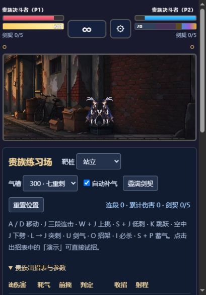

# 百兽夜行 · 贵族 V3

浏览器 2D 格斗游戏，包含本地双人、在线房间和贵族练习场。当前重点完善的角色是贵族决斗者：25 个动画状态、112 张独立动作帧，配套连招、招架、剑气、分档必杀及练习场招式演示。



## 从源码运行

准备 Node.js 18 或以上版本，在项目目录执行：

```sh
node launch-game.cjs
```

浏览器会自动打开主菜单，启动窗口会显示实际地址。默认使用 3010 端口；端口被占用时自动选择空闲端口。也可直接运行：

```sh
node launch-game.cjs --practice=noble
```

Windows 下可双击 `开始游戏.cmd` 或 `贵族练习场.cmd`。从 GitHub 下载的源码需要本机已安装 Node.js；便携 ZIP 内附 Windows x64 运行环境，完整解压后即可双击运行。

游戏期间保留启动窗口，关闭窗口或按 Ctrl+C 即可停止服务。本机游玩无需联网，不需要执行 `npm install`。

如需固定端口或手动打开浏览器：

```sh
node launch-game.cjs --no-open --port=3010
```

## 游玩与联机

主菜单提供本地双人、在线房间与贵族练习场入口，按键以游戏内提示为准。练习场可以设置对手状态和气量，并逐一演示招式。

同一局域网联机时，两台电脑都访问主机启动窗口显示的同一个“局域网地址”，再创建和加入同一个房间。主机需要保持运行。

完整招式、帧数和机制见 [贵族动作与参数](NOBLE-V3.md)，便携包使用方式见 [使用说明](使用说明.txt)。

## 工程文件

| 路径 | 内容 |
| --- | --- |
| `index.html`、`style.css`、`practice.css` | 游戏页面和界面 |
| `js/` | 角色、战斗、动画、练习场与联机逻辑 |
| `assets/chars/noble/v3/` | 贵族动画、清单及招式数据 |
| `assets/ref/` | 原始参考图与动作源图 |
| `tools/` | 素材制作、动画预览及回归检查工具 |
| `server.js` | 静态资源服务和 WebSocket 房间中继 |
| `launch-game.cjs` | 跨目录启动、端口选择与浏览器入口 |

服务端使用 Node.js 内置模块，无第三方 npm 依赖。素材制作工具的依赖以各脚本为准。

## 检查

```sh
node tools/test-anims.js
node tools/test-noble-combat.js
```

服务运行后可验证房间创建、加入、双向消息和断线处理：

```sh
node test-ws.js
```

联机检查默认连接 `ws://127.0.0.1:3010/ws`，自定义端口时通过 `TEST_WS_URL` 环境变量指定。

Git 仓库保留工程源码和素材；本地日志、依赖、便携运行环境及生成的压缩包不进入源码提交。
